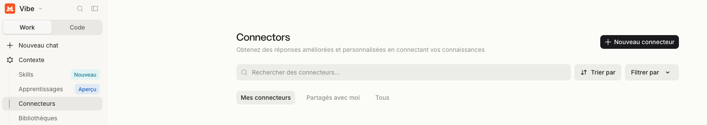
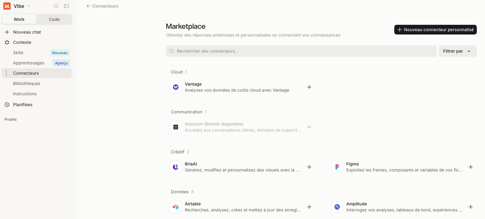
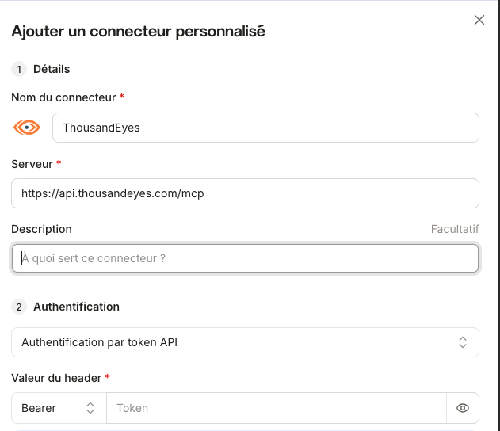
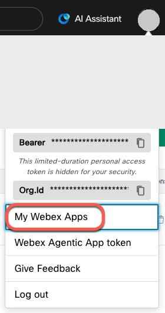
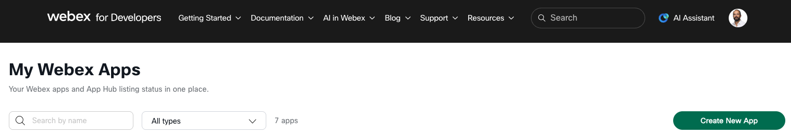
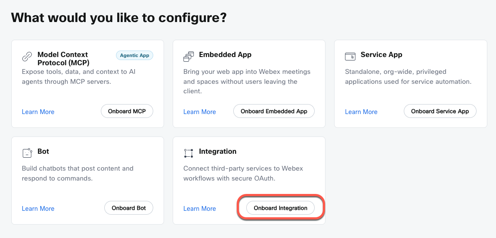
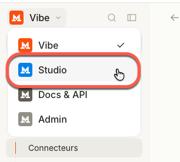
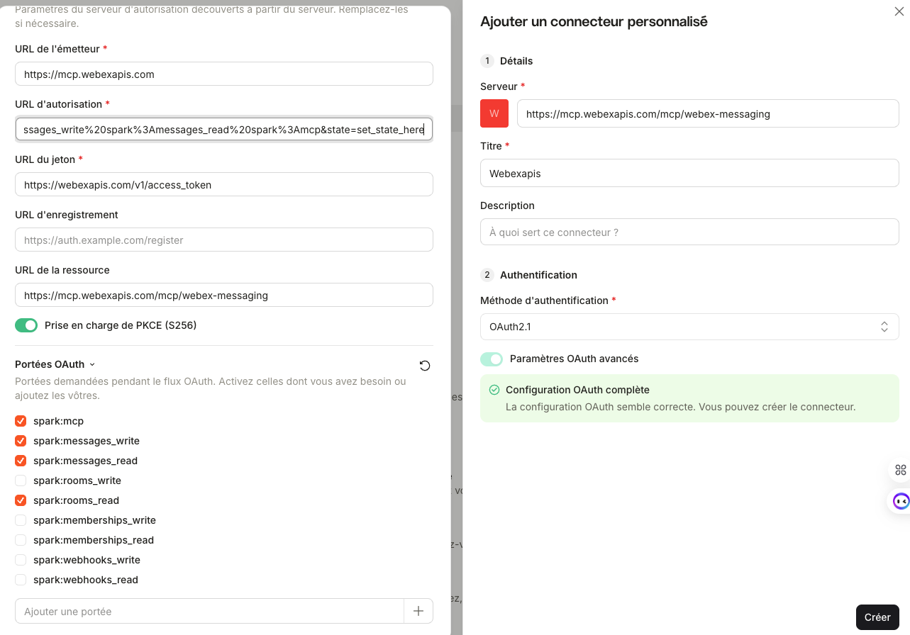
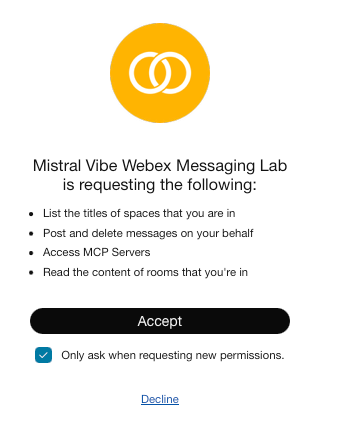

# Lab M'Ambassadeurs : ThousandEyes, Meraki et Webex dans Mistral Vibe

Dans ce lab, on branche trois serveurs MCP Cisco sur Mistral Vibe avec un simple compte gratuit, puis on les interroge en français, comme on parlerait à un collègue.

Comptez environ 45 minutes :

| Étape | Contenu | Durée |
|---|---|---|
| 0 | Préparer Mistral Vibe | 5 min |
| 1 | ThousandEyes | 10 min |
| 2 | Meraki | 10 min |
| 3 | Webex Messaging | 15 min |
| 4 | Les trois ensemble | 5 min |

> [!IMPORTANT]
> Ce dépôt ne contient aucun token ni aucune clé API. L'animateur vous les donne le jour du lab. Quand vous voyez `<...>` dans le guide, remplacez-le par la valeur qu'il vous a remise.

> [!TIP]
> Vous préférez un autre outil ? Si vous avez déjà vos habitudes avec Claude Code, Codex, Cursor ou VS Code, gardez-les. Les trois serveurs MCP sont des endpoints HTTP standards et marchent avec n'importe quel client MCP. Seule l'interface change, pas les URL ni les tokens. Quelques exemples sont donnés à la fin du guide, dans [Utiliser un autre client MCP](#utiliser-un-autre-client-mcp).

## Les endpoints

| Service | URL |
|---|---|
| ThousandEyes | `https://api.thousandeyes.com/mcp` |
| Meraki | `https://mcp.meraki.com/mcp` |
| Webex Messaging | `https://mcp.webexapis.com/mcp/webex-messaging` |

## Ce qu'il vous faut

- [ ] Un compte gratuit Mistral AI pour accéder à Mistral Vibe ([chat.mistral.ai](https://chat.mistral.ai)). Un navigateur suffit.
- [ ] Un token ThousandEyes qui a la permission *API Access*. Il est fourni pour le lab.
- [ ] Une clé API Meraki Dashboard. Elle est aussi fournie.
- [ ] Un compte Webex, et une intégration OAuth créée depuis votre profil [developer.webex.com](https://developer.webex.com).
- [ ] Un espace Webex de test sans rien de sensible dedans, par exemple « M'Ambassadeurs ».

## Schéma du lab

<p align="center">
</p>

<br>
<br>

## Étape 0 : préparer Mistral Vibe

1. Connectez-vous sur [chat.mistral.ai](https://chat.mistral.ai).
2. Dans le menu de gauche, ouvrez **Contexte**, puis **Connecteurs**.
3. Cliquez sur **Nouveau connecteur**, puis sur **Nouveau connecteur personnalisé**.

<p align="center"></p>

<p align="center"></p>

Pour chaque serveur, Mistral vous demande trois informations :

- **Un nom**, par exemple `ThousandEyes`, `Meraki` ou `Webex-Messaging`.
- **L'URL du serveur MCP**.
- **La méthode d'authentification**, soit un token (`Authorization: Bearer <TOKEN>`), soit OAuth.

<br>
<br>

## Étape 1 : ThousandEyes

### Créer le connecteur

1. Allez dans **Contexte**, puis **Connecteurs**, puis **Nouveau connecteur**, puis **Nouveau connecteur personnalisé**.
2. Remplissez :
   - Nom : `ThousandEyes`
   - Serveur : `https://api.thousandeyes.com/mcp`
   - Authentification : *Authentification par token API*
   - Bearer : `<TOKEN_THOUSANDEYES>`

   <p align="center"></p>

3. Enregistrez, puis vérifiez que le statut indique une connexion valide.

> [!NOTE]
> Collez le token seul. Mistral ajoute lui-même le mot `Bearer`.

### Tester

Ouvrez une nouvelle conversation et collez ce prompt :

```text
Utilise uniquement le serveur MCP thousandeyes. Liste les tests ThousandEyes configurés et retourne au maximum les cinq premiers, avec leur nom et leur type si disponibles. N'effectue aucun changement, ne lance pas de test actif et ne modifie aucune configuration.
```

Vous devriez voir apparaître de vrais tests ThousandEyes. Si ça ne marche pas, vérifiez d'abord que le token a bien la permission *API Access*.

<br>
<br>

## Étape 2 : Meraki

### La clé API

Pour le lab, utilisez la clé fournie par l'animateur (`<CLE_API_MERAKI>`).

Pour générer la vôtre une fois de retour chez vous :

1. Connectez-vous sur [dashboard.meraki.com](https://dashboard.meraki.com).
2. Ouvrez **Organization**, puis **API & Webhooks** (ou passez par votre profil, rubrique **Clés API**).
3. Générez une nouvelle clé.

> [!WARNING]
> Une clé API Meraki a les mêmes droits que le compte qui l'a créée. Pour ce genre de test, créez-la depuis un compte en lecture seule.

### Créer le connecteur

1. Allez dans **Contexte**, puis **Connecteurs**, puis **Nouveau connecteur**, puis **Nouveau connecteur personnalisé**.
2. Remplissez :
   - Nom : `Meraki`
   - Serveur : `https://mcp.meraki.com/mcp`
   - Authentification : *Authentification par token API*
   - Bearer : `<CLE_API_MERAKI>`
3. Cliquez sur **Ajouter un connecteur**.

### Tester

```text
Utilise uniquement le serveur MCP meraki. Recherche les organisations et réseaux Meraki auxquels la clé API donne accès. Retourne uniquement les noms et identifiants des cinq premiers résultats maximum. Ne modifie aucune configuration et n'exécute aucune action d'écriture.
```

Vous devriez obtenir la liste des organisations et des networks accessibles. Si rien ne remonte, vérifiez que la clé a été copiée en entier (elle fait 40 caractères) et que l'accès API est activé sur l'organisation.

<br>
<br>

## Étape 3 : Webex Messaging

Endpoint : `https://mcp.webexapis.com/mcp/webex-messaging`

Pour Webex, on passe par une intégration OAuth. C'est un peu plus long que pour les deux autres, mais la connexion ne tombe pas au bout de 12 heures.

### Créer l'intégration côté Webex

1. Connectez-vous sur [developer.webex.com](https://developer.webex.com), cliquez sur votre avatar, puis sur **My Webex Apps**.

   <p align="center"></p>

2. Cliquez sur **Create New App**.

   <p align="center"></p>

3. Choisissez **Integration** en cliquant sur **Onboard Integration**.

   <p align="center"></p>

4. Remplissez :
   - Integration Name : `Mistral Vibe Webex Messaging Lab`
   - Icon : celle que vous voulez
   - App Hub Description : `Mistral Vibe Webex Messaging Lab`
   - Redirect URL : `https://callback.mistral.ai/v1/integrations_auth/oauth2_callback`
   - Scopes : `spark:mcp`, `spark:rooms_read`, `spark:messages_read`, `spark:messages_write`
5. Cliquez sur **Add Integration**.
6. Notez le **Client ID**, le **Client Secret** et l'**OAuth Authorization URL**.

> [!TIP]
> La liste des scopes est longue. Utilisez Ctrl+F (ou Cmd+F) pour retrouver les quatre plus vite.

> [!CAUTION]
> Webex n'affiche le Client Secret qu'une seule fois. Copiez-le tout de suite.

### Créer le connecteur dans Mistral Studio

1. En haut à gauche, cliquez sur **Vibe** et basculez sur **Studio**.

   <p align="center"></p>

2. Dans le menu de gauche, ouvrez **Connecteurs**, puis **Nouveau connecteur** et **Nouveau connecteur personnalisé**.
3. Serveur : `https://mcp.webexapis.com/mcp/webex-messaging`
4. Quelques secondes plus tard, une deuxième fenêtre s'ouvre. Renseignez :
   - le Client ID ;
   - le Client Secret ;
   - l'URL d'autorisation, en remplaçant la valeur proposée par l'OAuth Authorization URL copiée chez Webex.
5. Dans **Portées OAuth**, décochez `spark:rooms_write`, `spark:memberships_write`, `spark:memberships_read`, `spark:webhooks_write` et `spark:webhooks_read`. Il doit rester `spark:mcp`, `spark:messages_write`, `spark:messages_read` et `spark:rooms_read`.

   Votre configuration doit ressembler à ça :

   <p align="center"></p>

6. Cliquez sur **Créer**. Webex vous demande alors d'autoriser Mistral Vibe : cliquez sur **Accept**.

   <p align="center"></p>

> [!NOTE]
> Le connecteur s'appelle ici **Webexapis**. C'est ce nom qu'on utilise dans les prompts.

### Tester en lecture

Avant ce test, publiez à la main un message témoin dans l'espace « M'Ambassadeurs », par exemple `TEST-MISTRAL-MCP-2026`. Revenez ensuite dans Mistral Vibe :

```text
Utilise exclusivement le serveur MCP Webexapis. Recherche l'espace Webex dont le nom exact est « M'Ambassadeurs ». Retourne uniquement son nom et son identifiant technique. Ne liste pas les autres espaces et n'effectue aucune action d'écriture. Si l'espace n'est pas trouvé, indique-le sans élargir la recherche.
```

Vous devez récupérer le nom et l'identifiant de l'espace.

### Tester en écriture

```text
Utilise exclusivement le serveur MCP Webexapis. Dans l'espace Webex « M'Ambassadeurs », envoie : « Test Mistral Vibe MCP : message envoyé avec succès. » Vérifie que l'espace ciblé correspond exactement à ce nom. N'envoie rien ailleurs. Indique si l'outil confirme la création du message et retourne son identifiant si disponible.
```

Le message doit apparaître dans l'espace. Si ce n'est pas le cas, vérifiez que le scope `spark:messages_write` est coché, côté Webex comme côté Mistral, et que vous faites bien partie de l'espace.

<br>
<br>

## Étape 4 : les trois ensemble

Une seule demande suffit pour faire travailler les trois connecteurs :

```text
1. Avec le serveur MCP meraki, liste les réseaux de la première organisation accessible (cinq maximum).
2. Avec le serveur MCP thousandeyes, liste les alertes actives (cinq maximum).
3. Rédige un résumé de cinq lignes maximum de l'état du réseau et des alertes.
4. Avec le serveur MCP Webexapis, publie ce résumé dans l'espace « M'Ambassadeurs ».
N'effectue aucune modification sur Meraki ni sur ThousandEyes.
```

Si tout fonctionne, un résumé du réseau et des alertes est publié dans votre espace Webex.

> [!NOTE]
> Commencer chaque prompt par « Utilise uniquement le serveur MCP … » évite que le modèle aille chercher la réponse ailleurs. Et rappeler « ne modifie rien » ne coûte rien, même avec des clés en lecture seule.

---

## Si ça coince

| Ce que vous voyez | Cause probable | Ce qu'il faut faire |
|---|---|---|
| Connecteur en « Échec de connexion » | URL ou header incorrect | Vérifiez l'URL HTTPS du serveur MCP, puis le token |
| `401 Unauthorized` | Le token est mal copié | Recollez-le seul, sans `Bearer ` ni espace autour |
| `403 Forbidden` | Il manque un droit | ThousandEyes : *API Access*. Meraki : accès API activé. Webex : les scopes |
| Token Webex refusé | Personal Access Token expiré (12 h) | Régénérez-le sur developer.webex.com et mettez à jour le connecteur |
| Le connecteur n'est pas proposé dans le chat | Il n'est pas activé pour cette conversation | Activez-le dans le sélecteur d'outils de la conversation |
| Le modèle utilise le mauvais outil | Le prompt est trop vague | Commencez par « Utilise uniquement le serveur MCP … » |

## Utiliser un autre client MCP

Les URL et les tokens sont les mêmes partout. Voici deux exemples pour Meraki, que vous pouvez adapter aux deux autres serveurs.

**Claude Code**

```bash
claude mcp add --transport http meraki https://mcp.meraki.com/mcp --header "Authorization: Bearer <CLE_API_MERAKI>"
```

**Codex** (`~/.codex/config.toml`)

```toml
[mcp_servers.meraki]
url = "https://mcp.meraki.com/mcp"
bearer_token_env_var = "MERAKI_API_KEY"
```

> [!NOTE]
> Ces commandes changent d'une version à l'autre. En cas de doute, regardez la documentation de votre client à la rubrique « remote MCP » ou « streamable HTTP ».

## Documentation officielle

- [Mistral : MCP](https://docs.mistral.ai/guides/mcp/)
- [ThousandEyes MCP Server](https://docs.thousandeyes.com/product-documentation/integration-guides/thousandeyes-mcp-server)
- [Meraki MCP Server](https://developer.cisco.com/meraki/api-v1/mcp-server/)
- [Webex Messaging MCP Server](https://developer.webex.com/mcp/docs/messaging-mcp-server)

## Avant de partir

1. Supprimez les trois connecteurs dans **Contexte**, puis **Connecteurs**.
2. Supprimez l'intégration Webex depuis **My Webex Apps**.

L'animateur révoque les clés du lab à la fin de la session.

---

## Contribuer

Avant chaque commit, lancez le contrôle anti-fuite :

```bash
./scripts/check-secrets.sh
```

Il refuse le commit s'il trouve quelque chose qui ressemble à une clé Meraki, un token ThousandEyes ou un token Webex. Tous les prompts du lab sont aussi disponibles séparément dans [`prompts/`](prompts/).
