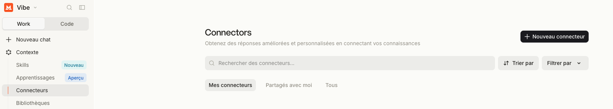
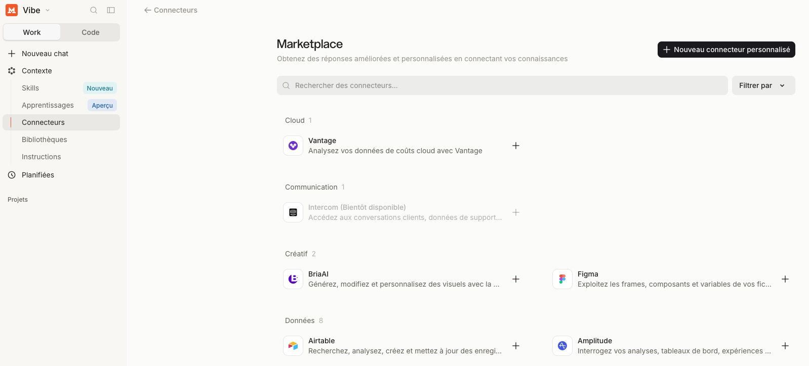
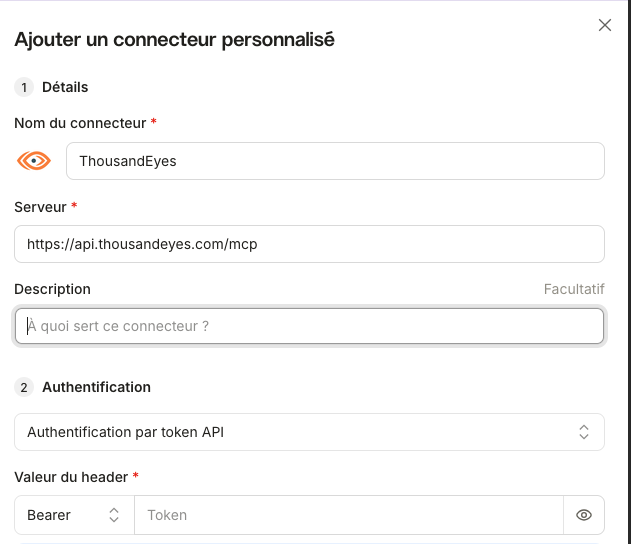
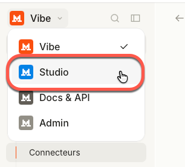
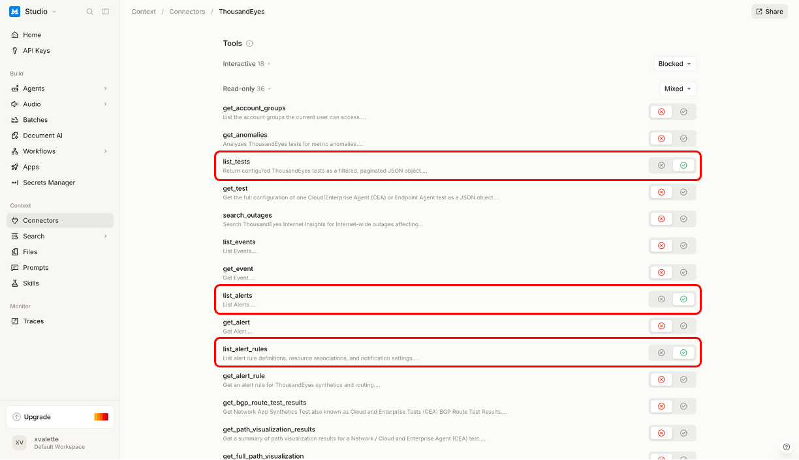
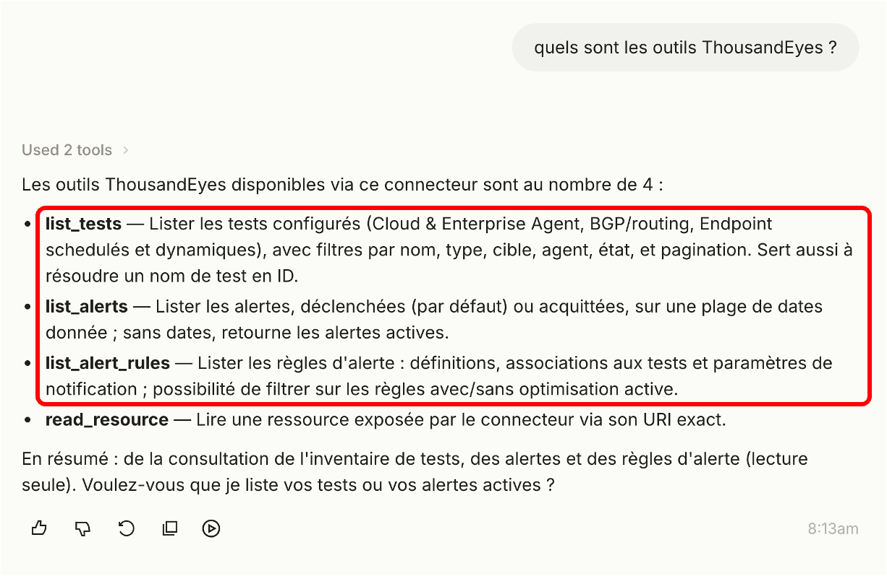
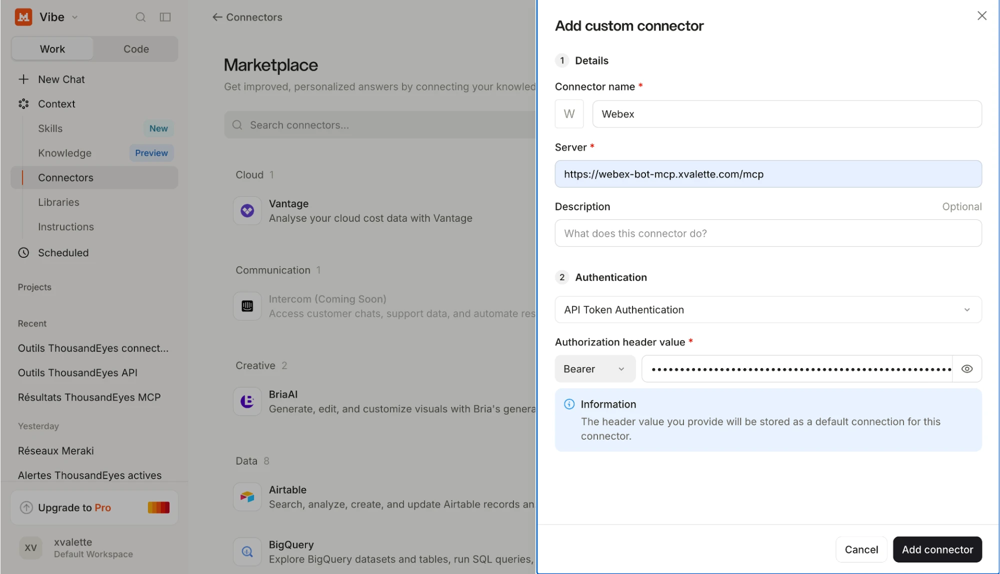

<p align="center">
  <a href="https://git.io/typing-svg"></a>
</p>


# Lab M'Ambassadeurs : ThousandEyes, Meraki et Webex dans Mistral Vibe
<br>

## Introduction


### L'objectif

Dans ce lab, on branche trois serveurs MCP Cisco sur Mistral Vibe avec un simple compte gratuit, puis on les interroge en français, comme on parlerait à un collègue.

<p align="center"></p>


### L'agenda

Comptez environ 45 minutes :

<table>
  <tr>
    <th width="150" align="left">Étape</th>
    <th width="700" align="left">Contenu</th>
    <th width="150" align="left">Durée</th>
  </tr>
  <tr>
    <td>Étape 0</td>
    <td><a href="#étape-0--préparer-mistral-vibe">Préparer Mistral Vibe</a></td>
    <td>5 min</td>
  </tr>
  <tr>
    <td>Étape 1</td>
    <td><a href="#étape-1--connecter-thousandeyes">Connecter ThousandEyes</a></td>
    <td>10 min</td>
  </tr>
  <tr>
    <td>Étape 2</td>
    <td><a href="#étape-2--connecter-meraki">Connecter Meraki</a></td>
    <td>10 min</td>
  </tr>
  <tr>
    <td>Étape 3</td>
    <td><a href="#étape-3--connecter-webex">Connecter Webex</a></td>
    <td>5 min</td>
  </tr>
  <tr>
    <td>Étape 4</td>
    <td><a href="#étape-4--les-trois-ensemble">Les trois ensemble</a></td>
    <td>5 min</td>
  </tr>
  <tr>
    <td>Étape 5</td>
    <td><a href="#étape-5--installer-le-skill-de-triage">Installer le skill de triage</a></td>
    <td>10 min</td>
  </tr>
</table>
<br>


### Les prérequis

- [ ] Un compte Webex, pour voir les messages arriver dans l'espace « M'Ambassadeurs ». Demandez à l'animateur de vous y ajouter.


<br>
<br>

## Étape 0 : Préparer Mistral Vibe
> [!TIP]
> Vous préférez un autre harnais ? Si vous avez déjà vos habitudes avec Claude Code, Codex, Cursor ou VS Code, gardez-les. Les trois serveurs MCP sont des endpoints HTTP standards et marchent avec n'importe quel client MCP. Seule l'interface change, pas les URL ni les tokens. Quelques exemples sont donnés à la fin du guide, dans [Utiliser un autre client MCP](#utiliser-un-autre-client-mcp).

1. Connectez-vous sur [chat.mistral.ai](https://chat.mistral.ai).
2. Dans le menu de gauche, ouvrez **Contexte**, puis **Connecteurs**.
3. Cliquez sur **Nouveau connecteur**, puis sur **Nouveau connecteur personnalisé**.

<p align="center"></p>

<p align="center"></p>

Pour chaque serveur, Mistral vous demande trois informations :

- **Un nom**, par exemple `ThousandEyes`, `Meraki` ou `Webex`.
- **L'URL du serveur MCP**.
- **La méthode d'authentification**, soit un token (`Authorization: Bearer <TOKEN>`), soit OAuth.

> [!IMPORTANT]
> Ce dépôt ne contient aucun token ni aucune clé API. L'animateur vous les donne le jour du lab. Quand vous voyez `<...>` dans le guide, remplacez-le par la valeur qu'il vous a remise.
<br>
<br>

## Étape 1 : Connecter ThousandEyes

### Créer le connecteur

1. Allez dans **Contexte**, puis **Connecteurs**, puis **Nouveau connecteur**, puis **Nouveau connecteur personnalisé**.
2. Remplissez :
   - Nom : `ThousandEyes`
   - Serveur : `https://api.thousandeyes.com/mcp`
   - Authentification : *Authentification par token API*
   - Bearer : `<TOKEN_THOUSANDEYES>`

   <p align="center"></p>

3. Enregistrez, puis vérifiez que le statut indique une connexion valide.

> [!NOTE]
> Collez le token seul. Mistral ajoute lui-même le mot `Bearer`.

### Ne garder que les outils utiles

Le serveur MCP ThousandEyes expose 54 outils : 36 en lecture seule, et 18 « interactifs » qui peuvent créer, modifier ou supprimer des tests, des alertes ou des dashboards. Pour ce lab, on a besoin de trois outils seulement :

- `list_tests` pour lister les tests configurés ;
- `list_alerts` pour récupérer les alertes actives ;
- `list_alert_rules` pour voir les règles d'alerte.

Une bonne pratique est de bloquer tous les autres. Les harnais récents, Vibe compris, ne chargent plus la description et le schéma de chaque outil dans le contexte dès le départ. Ils vont les chercher à la demande. Les 54 outils ne remplissent donc pas le contexte à chaque message. Mais le jour où le modèle ouvre le connecteur ThousandEyes, il voit toute la liste. Plus elle est courte, moins il a de chances de se tromper d'outil, et moins on consomme de contexte pour rien.

Il y a aussi un argument de sécurité. Écrire « ne modifie rien » dans un prompt, c'est une consigne que le modèle respecte en général. Bloquer les 18 outils interactifs, c'est une garantie : même s'il le voulait, il ne pourrait pas supprimer un test.

Pour filtrer :

1. En haut à gauche, basculez de **Vibe** vers **Studio**.

   <p align="center"></p>

2. Ouvrez **Connectors**, puis le connecteur **ThousandEyes**.
3. Dans **Tools**, passez **Interactive** en **Blocked**.
4. Dans **Read-only**, bloquez tout, sauf `list_tests`, `list_alerts` et `list_alert_rules`.

<p align="center"></p>

Pour vérifier, revenez dans Vibe et demandez « quels sont les outils ThousandEyes ? ». Vous devez retrouver vos trois outils.

<p align="center"></p>

> [!NOTE]
> Vibe affiche aussi un quatrième outil, `read_resource`. Il ne fait pas partie des 54 outils ThousandEyes : c'est la fonction standard d'un client MCP pour lire les documents qu'un serveur met à disposition. Le serveur ThousandEyes n'en propose aucun, donc vous pouvez l'ignorer.

### Tester

Ouvrez une nouvelle conversation et collez ce prompt :

```text
Utilise uniquement le serveur MCP thousandeyes. Liste les tests ThousandEyes configurés et retourne au maximum les cinq premiers, avec leur nom et leur type si disponibles. N'effectue aucun changement, ne lance pas de test actif et ne modifie aucune configuration.
```

Vous devriez voir apparaître de vrais tests ThousandEyes. Si ça ne marche pas, vérifiez d'abord que le token a bien la permission *API Access*.

> [!NOTE]
> **Combien pèsent les 54 outils ?** Vous pouvez le mesurer vous-même. Un client MCP découvre les outils d'un serveur avec la méthode `tools/list`, et rien ne vous empêche de l'appeler à la main :
>
> ```bash
> export TE_TOKEN="<TOKEN_THOUSANDEYES>"
> curl -s https://api.thousandeyes.com/mcp \
>   -H "Authorization: Bearer $TE_TOKEN" \
>   -H "Content-Type: application/json" \
>   -H "Accept: application/json, text/event-stream" \
>   -d '{"jsonrpc":"2.0","id":1,"method":"tools/list","params":{}}' > thousandeyes-tools.txt
> ```
>
> Collez ensuite le contenu du fichier dans un compteur de tokens comme le [tokenizer d'OpenAI](https://platform.openai.com/tokenizer). On obtient environ **54 000 tokens**, uniquement pour décrire les outils, avant même la première question. Les trois outils gardés pour le lab n'en pèsent qu'environ **4 000**.

<br>
<br>

## Étape 2 : Connecter Meraki

### La clé API

Pour le lab, utilisez la clé fournie par l'animateur (`<CLE_API_MERAKI>`).

Pour générer la vôtre une fois de retour chez vous :

1. Connectez-vous sur [dashboard.meraki.com](https://dashboard.meraki.com).
2. Ouvrez **Organization**, puis **API & Webhooks** (ou passez par votre profil, rubrique **Clés API**).
3. Générez une nouvelle clé.

> [!WARNING]
> Une clé API Meraki a les mêmes droits que le compte qui l'a créée. Pour ce genre de test, créez-la depuis un compte en lecture seule.

### Créer le connecteur

1. Allez dans **Contexte**, puis **Connecteurs**, puis **Nouveau connecteur**, puis **Nouveau connecteur personnalisé**.
2. Remplissez :
   - Nom : `Meraki`
   - Serveur : `https://mcp.meraki.com/mcp`
   - Authentification : *Authentification par token API*
   - Bearer : `<CLE_API_MERAKI>`
3. Cliquez sur **Ajouter un connecteur**.

### Tester

```text
Utilise uniquement le serveur MCP meraki. Recherche les organisations et réseaux Meraki auxquels la clé API donne accès. Retourne uniquement les noms et identifiants des cinq premiers résultats maximum. Ne modifie aucune configuration et n'exécute aucune action d'écriture.
```

Vous devriez obtenir la liste des organisations et des networks accessibles. Si rien ne remonte, vérifiez que la clé a été copiée en entier (elle fait 40 caractères) et que l'accès API est activé sur l'organisation.

<br>
<br>

## Étape 3 : Connecter Webex

Endpoint : `https://webex-bot-mcp.xvalette.com/mcp`

Pour Webex, on n'utilise pas le serveur MCP officiel de Cisco, mais un serveur MCP écrit pour le lab. Son code est dans ce dépôt, dans le dossier [`mcp/webex`](mcp/webex/README.md).

> [!NOTE]
> **Pourquoi un serveur MCP custom ?** Il y a deux raisons.
>
> 1. **Les comptes Webex gratuits n'ont pas accès au serveur MCP officiel.**
> 2. **On voulait des garde-fous solides.** Le serveur officiel donne au modèle l'accès à toute votre messagerie : il peut écrire dans n'importe quel espace, ou en direct à n'importe qui, en votre nom. Notre serveur n'expose qu'un seul outil, `send_webex_message`, qui prend un seul paramètre : le texte du message. L'identifiant de l'espace est fixé en dur dans la configuration du serveur, et le message part au nom d'un bot, pas au vôtre. Le modèle ne peut donc écrire que dans l'espace « M'Ambassadeurs », quoi qu'on lui demande.

### Créer le connecteur

1. Allez dans **Contexte**, puis **Connecteurs**, puis **Nouveau connecteur**, puis **Nouveau connecteur personnalisé**.
2. Remplissez :
   - Nom : `Webex`
   - Serveur : `https://webex-bot-mcp.xvalette.com/mcp`
   - Authentification : *Authentification par token API*
   - Bearer : `<TOKEN_MCP_WEBEX>`, fourni par l'animateur

   <p align="center"></p>

3. Cliquez sur **Ajouter un connecteur**.

> [!TIP]
> L'espace est verrouillé, mais c'est toujours le modèle qui rédige le texte. Pour relire chaque message avant qu'il parte, ouvrez le connecteur **Webex** dans **Studio** et réglez l'outil `send_webex_message` sur **Demander**. Vibe vous montrera alors le message, et vous pourrez l'approuver ou le refuser.

### Tester

```text
Utilise uniquement le serveur MCP Webex. Envoie le message « Test Mistral Vibe MCP : message envoyé avec succès. » et indique si l'outil confirme l'envoi.
```

Le message doit apparaître dans l'espace « M'Ambassadeurs », publié par le bot. Pas besoin de préciser l'espace dans le prompt : le serveur le connaît déjà.

> [!TIP]
> Vous voulez faire tourner le même serveur avec votre propre bot et votre propre espace ? Tout est expliqué dans [`mcp/webex/README.md`](mcp/webex/README.md) : création du bot, configuration, lancement avec `uv` et exposition avec un tunnel Cloudflare.

<br>
<br>

## Étape 4 : Les trois ensemble

Une seule demande suffit pour faire travailler les trois connecteurs :

```text
1. Avec le serveur MCP meraki, liste les réseaux de la première organisation accessible (cinq maximum).
2. Avec le serveur MCP thousandeyes, liste les alertes actives (cinq maximum).
3. Rédige un résumé de cinq lignes maximum de l'état du réseau et des alertes.
4. Avec le serveur MCP Webex, publie ce résumé.
N'effectue aucune modification sur Meraki ni sur ThousandEyes.
```

Si tout fonctionne, un résumé du réseau et des alertes est publié dans l'espace Webex « M'Ambassadeurs ».

> [!NOTE]
> Commencer chaque prompt par « Utilise uniquement le serveur MCP … » évite que le modèle aille chercher la réponse ailleurs. Et rappeler « ne modifie rien » ne coûte rien, même avec des clés en lecture seule.

<br>
<br>

## Étape 5 : Installer le skill de triage

Jusqu'ici, on a écrit chaque prompt à la main. Un skill permet d'enregistrer une méthode une fois pour toutes. Celui-ci, [`te-meraki-alert-triage`](skills/te-meraki-alert-triage/SKILL.md), prend en charge une alerte ThousandEyes de bout en bout :

1. il liste les alertes actives ;
2. il retrouve le réseau Meraki qui porte le nom de l'agent ThousandEyes en alerte ;
3. il vérifie l'état des liens WAN et des équipements de ce réseau ;
4. il cherche les changements de configuration et les événements survenus dans les 5 à 10 minutes avant l'alerte ;
5. il conclut avec une cause probable et des actions recommandées.

Vibe ne charge que le nom et la description du skill au démarrage. Les instructions complètes ne sont lues que lorsqu'une demande correspond, exactement comme pour les outils MCP.

### Créer le skill dans Studio

1. Ouvrez [`skills/te-meraki-alert-triage/SKILL.md`](skills/te-meraki-alert-triage/SKILL.md) et cliquez sur **Raw** pour afficher le texte brut.
2. Dans **Studio**, ouvrez **Context**, puis **Skills**, et cliquez sur **New Skill**.
3. Remplissez :
   - **Title** : `te-meraki-alert-triage`
   - **Description** : le texte du champ `description:` en haut du fichier
   - **Instructions** : tout ce qui suit la deuxième ligne `---`
4. Cliquez sur **Create Skill**.
5. Sur la page du skill, cliquez sur **Publish to Vibe**. Sans cette étape, le skill reste visible dans Studio mais Vibe ne le voit pas.

> [!IMPORTANT]
> Le skill fait le lien entre les deux services grâce à une convention : **le réseau Meraki porte le même nom que l'agent ThousandEyes**. C'est le cas dans l'environnement du lab. Chez vous, si les noms ne correspondent pas, le skill vous demandera quel réseau analyser.

### Tester

Ouvrez une nouvelle conversation dans Vibe :

```text
J'ai reçu une alerte ThousandEyes, analyse-la.
```

Vous pouvez aussi appeler le skill directement en tapant `/te-meraki-alert-triage`.

La réponse doit suivre cinq parties, dans cet ordre : alertes actives, santé des liens WAN, état des équipements, changements survenus avant l'alerte, recommandations.

> [!NOTE]
> Pour retrouver le nom de l'agent, le skill peut avoir besoin de l'outil ThousandEyes `get_test`. Si vous l'avez bloqué à l'étape 1 et que le skill bloque à cet endroit, débloquez-le : c'est un outil en lecture seule.

> [!TIP]
> Le skill ne fait que lire. Pour aller plus loin, demandez-lui ensuite de publier son analyse dans l'espace « M'Ambassadeurs » avec le connecteur Webex. Si vous avez réglé `send_webex_message` sur **Demander** à l'étape 3, vous pourrez relire le message avant qu'il parte.

<details>
<summary><h2>Si ça coince</h2></summary>

| Ce que vous voyez | Cause probable | Ce qu'il faut faire |
|---|---|---|
| Connecteur en « Échec de connexion » | URL ou header incorrect | Vérifiez l'URL HTTPS du serveur MCP, puis le token |
| `401 Unauthorized` | Le token est mal copié | Recollez-le seul, sans `Bearer ` ni espace autour |
| `403 Forbidden` | Il manque un droit | ThousandEyes : *API Access*. Meraki : accès API activé. Webex : le token MCP fourni par l'animateur |
| Le connecteur n'est pas proposé dans le chat | Il n'est pas activé pour cette conversation | Activez-le dans le sélecteur d'outils de la conversation |
| Le modèle utilise le mauvais outil | Le prompt est trop vague | Commencez par « Utilise uniquement le serveur MCP … » |

</details>

<details>
<summary><h2>Utiliser un autre client MCP</h2></summary>

Les URL et les tokens sont les mêmes partout. Voici deux exemples pour Meraki, que vous pouvez adapter aux deux autres serveurs.

**Claude Code**

```bash
claude mcp add --transport http meraki https://mcp.meraki.com/mcp --header "Authorization: Bearer <CLE_API_MERAKI>"
```

**Codex** (`~/.codex/config.toml`)

```toml
[mcp_servers.meraki]
url = "https://mcp.meraki.com/mcp"
bearer_token_env_var = "MERAKI_API_KEY"
```

> [!NOTE]
> Ces commandes changent d'une version à l'autre. En cas de doute, regardez la documentation de votre client à la rubrique « remote MCP » ou « streamable HTTP ».

</details>

<details>
<summary><h2>Documentation officielle</h2></summary>

- [Mistral : MCP](https://docs.mistral.ai/guides/mcp/)
- [ThousandEyes MCP Server](https://docs.thousandeyes.com/product-documentation/integration-guides/thousandeyes-mcp-server)
- [Meraki MCP Server](https://developer.cisco.com/meraki/api-v1/mcp-server/)
- [FastMCP](https://gofastmcp.com), utilisé pour le serveur MCP Webex du lab
- [Webex : créer un bot](https://developer.webex.com/messaging/docs/bots)

</details>

<details>
<summary><h2>Avant de partir</h2></summary>

1. Supprimez les trois connecteurs dans **Contexte**, puis **Connecteurs**.

L'animateur révoque les clés du lab à la fin de la session.

</details>
